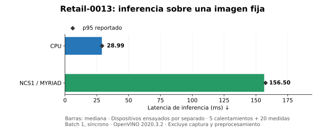

# Intel NCS Legacy Lab

Este proyecto reúne la configuración y las pruebas de **Intel Movidius Neural Compute Stick (NCS1)** y **Intel Neural Compute Stick 2 (NCS2)** en una Intel NUC con Ubuntu 24.04. Lo estamos preparando para las clases de sistemas ciberfísicos: instalar el entorno, ejecutar modelos en CPU y VPU, y comparar su rendimiento.

**Actualizado al 19 de octubre de 2026.** NCS1 ejecuta inferencia con OpenVINO 2020.3.2 en un contenedor Ubuntu 18.04. NCS2 aparece por USB y el plugin MYRIAD está disponible en OpenVINO 2022.3.2, pero la carga del firmware falla en este equipo. Hasta ahora, la CPU ha sido más rápida que el NCS1.

## Equipo y versiones

| Componente | Equipo utilizado |
|---|---|
| Computadora | Intel NUC7i3BNK, placa NUC7i3BNB |
| CPU | Intel Core i3-7100U, 2 núcleos / 4 hilos |
| Memoria y almacenamiento | 8 GB RAM, SSD de 128 GB |
| Anfitrión | Ubuntu 24.04.4 LTS, kernel observado `7.0.0-34-generic` |
| Cámara | Intel RealSense D435i, RGB por V4L2, 640 × 480 a 15 fps |
| NCS1 | Myriad 2; USB inicial `03e7:2150`, boot observado `03e7:f63b` |
| NCS2 | Myriad X; USB inicial `03e7:2485` |
| Entorno NCS1 | Ubuntu 18.04, Python 3.6, OpenVINO 2020.3.2 |
| Entorno NCS2 | Ubuntu 20.04, Python 3.8, OpenVINO 2022.3.2 |

Inicialmente identificamos la NUC como NUC5i7RYB, pero al consultar los datos DMI encontramos NUC7i3BNK / NUC7i3BNB. Conviene revisar el modelo de cada equipo antes de preparar el entorno: `cat /sys/class/dmi/id/product_name /sys/class/dmi/id/board_name`, `lscpu` y `uname -r`.

El 19 de octubre repetimos la instalación en una segunda NUC7i3BNK con Ubuntu 24.04.4 y kernel `7.0.0-38-generic`. En ese equipo comprobamos inferencia CPU/NCS1 y vídeo con una Logitech C910. [Instalación y pruebas de la segunda NUC](docs/instalacion-segunda-nuc.md).

## Por qué usar contenedores

La primera idea fue usar un `venv`. Para estos sticks también necesitamos versiones específicas de las bibliotecas nativas, el plugin MYRIAD y acceso USB para cargar el firmware. Por eso dejamos Ubuntu 24.04 en la NUC y preparamos un contenedor para cada generación. El kernel y la conexión USB siguen siendo los del sistema anfitrión.

## Acceso remoto por SSH (opcional)

Para preparar la NUC desde otra computadora, conecta ambos equipos a la misma red. En una terminal de la NUC instala y habilita el servidor SSH:

```bash
sudo apt update
sudo apt install openssh-server -y
sudo systemctl enable --now ssh
systemctl is-active ssh
```

El último comando debe mostrar `active`. Consulta el usuario, el nombre del equipo y su dirección IP:

```bash
whoami
hostname
hostname -I
```

Desde la otra computadora, conecta usando esos datos:

```bash
ssh usuario@nombre-del-equipo.local
# Si el nombre .local no resuelve, usa la dirección IP de la NUC:
ssh usuario@IP_DE_LA_NUC
```

Sustituye los valores por los de tu equipo e introduce la contraseña del usuario de la NUC. Si aparece `Connection refused`, comprueba que el servicio SSH esté activo y que la dirección corresponda a la NUC.

La instalación y la preparación de los contenedores pueden hacerse por SSH. Para abrir el visor de vídeo en la pantalla conectada a la NUC, ejecuta `./ncs1/live.sh both` desde una terminal de su escritorio gráfico.

## Inicio con NCS1

Ejecuta estos comandos desde el escritorio de la NUC x86_64. La preparación descarga el runtime de Intel y los pesos del modelo, por lo que requiere conexión a Internet.

```bash
sudo apt update
sudo apt install git -y
git clone https://github.com/GerardoDC14/intel-ncs-legacy-lab.git
cd intel-ncs-legacy-lab
./scripts/setup-host.sh
# Cerrar sesión y volver a entrar para aplicar los grupos USB/vídeo.
# Reconectar el stick después de aplicar las reglas USB.
./scripts/build-runtime.sh ncs1
./scripts/prepare-mobilenet.sh
./ncs1/live.sh both
```

`setup-host.sh` instala Docker, FFmpeg y las herramientas USB/V4L2. También configura los grupos `plugdev` y `video` y las reglas udev del stick. Los lanzadores usan `sudo docker`, mientras que el proceso dentro del contenedor se ejecuta con el UID del usuario.

El script de descarga comprueba que los archivos de Intel se puedan extraer y guarda su SHA256 local. No compara ese hash con uno del fabricante. Para MobileNet, los hashes de los pesos y del prototxt están fijados en el script y se comprueban antes de convertir el modelo.

Modos disponibles:

```bash
./ncs1/live.sh cpu
./ncs1/live.sh myriad
./ncs1/live.sh both --threshold 0.3
./ncs1/live.sh both --seconds 30
```

Cierra el visor con **Q o Esc**. Para comparar ambos dispositivos usa `both`; abrir dos lanzadores por separado puede causar conflictos de acceso a la cámara y al stick. `both` ejecuta un proceso por dispositivo y muestra dos paneles de una sola captura RGB. Cada panel dibuja las cajas sobre el fotograma que realmente procesó. Se descartan fotogramas pendientes para evitar una cola creciente.

Cada panel muestra latencia, inferencias/s, número de personas y tiempo transcurrido desde el resultado. La gráfica inferior muestra los últimos 30 segundos de latencia, promedios de 5 segundos y diferencia `NCS1 − CPU`. Un valor positivo indica mayor latencia del NCS1. La tasa de inferencias/s cuenta los resultados recibidos en la ventana de 5 segundos; no se calcula como el inverso de la latencia.

El visor utiliza el socket Xwayland y las credenciales de la sesión gráfica actual, sin `xhost +`. Lo probamos desde el escritorio local de la NUC. La cámara RGB YUYV se selecciona mediante V4L2; si hay varias cámaras, puedes indicar el dispositivo:

```bash
NCS_CAMERA=/dev/video4 ./ncs1/live.sh both
```

El número del dispositivo puede cambiar al reconectar la cámara. Aquí usamos únicamente RGB de la D435i. La cámara volvió a funcionar en el hub después de reconectarla; antes habíamos encontrado errores USB `-71`, cuya causa sigue pendiente.

## Modelo utilizado

El primer detector, `person-detection-retail-0013`, no detectaba adecuadamente a la persona sentada y parcialmente fuera de cuadro. Lo cambiamos por **MobileNet-SSD Caffe, VOC**, de [chuanqi305/MobileNet-SSD](https://github.com/chuanqi305/MobileNet-SSD), convertido a IR FP16 con Model Optimizer 2020.3.355.

Entrada BGR de 300 × 300, media 127.5 y escala 127.5 integradas en el IR; el visor entrega píxeles sin normalizarlos otra vez. La clase persona es `15` en VOC y el umbral inicial es 0.4. [Procedencia y conversión](docs/modelos.md).

MobileNet ejecuta inferencia tanto en CPU como en NCS1. Falta comprobar si mejora la detección de personas sentadas: la escena estaba vacía durante la prueba de rendimiento guardada. El umbral se puede ajustar, teniendo en cuenta que un valor más bajo puede aumentar los falsos positivos.

## Resultados

Las gráficas siguientes corresponden a la primera NUC, medidas el 30 de septiembre de 2026. Las pruebas del 19 de octubre en la segunda NUC se describen por separado en [Método y resultados](docs/mediciones.md#segunda-nuc-19-de-octubre-de-2026).


La gráfica corresponde al promedio de los últimos 5 segundos de una sesión con ambos dispositivos, CPU con 2 hilos y cámara a 15 fps. Se capturaron 125 fotogramas. CPU: **36.42 ms / 14.8 inferencias/s**. NCS1: **83.01 ms / 11.2 inferencias/s**. Diferencia de latencia: **+46.60 ms**, aproximadamente **2.28 veces** la latencia de CPU. No se midió consumo eléctrico ni uso global de CPU.



Esta segunda prueba usa otro modelo: retail-0013, imagen fija, batch 1, inferencia síncrona, 5 calentamientos y 20 medidas por dispositivo, ejecutados por separado. Mediana CPU: **28.99 ms**; NCS1: **156.50 ms**. No incluye captura ni preprocesamiento. Como cambia el modelo y el método de prueba, estos tiempos se comparan entre dispositivos dentro de cada ensayo.

En este equipo la CPU tiene menor latencia. Para la clase, la comparación permite trabajar con la carga de modelos en una VPU, la selección de dispositivo y la medición de inferencia sobre hardware real.

[Metodología, datos y resultados adicionales](docs/mediciones.md). Todos los gráficos pueden regenerarse con:

```bash
python3 -m venv .venv
.venv/bin/pip install -r scripts/requirements-plots.txt
.venv/bin/python scripts/plot_results.py
```

## Actualizar una instalación existente

Cierra el visor antes de actualizar. Desde la carpeta del repositorio:

```bash
git pull --ff-only
./ncs1/live.sh both
```

Los cambios de recuperación afectan al lanzador y al código Python; no requieren reconstruir la imagen Docker ni convertir de nuevo el modelo. Si tienes cambios locales, revísalos antes de actualizar.

## Recuperación del NCS1

En algunas aperturas el stick falla con `NC_ERROR` al cargar el modelo. Para reducir las reconexiones manuales, el visor libera explícitamente el modelo y el plugin al cerrar, y espera hasta 20 segundos antes de terminar un proceso que no responde. También impide abrir dos visores a la vez.

Si falla la inicialización de MYRIAD, el lanzador cierra el contenedor, solicita un reset USB del stick y vuelve a intentarlo **una sola vez**. Durante la recuperación la ventana se cierra y vuelve a abrirse. El script rechaza el reset si otro proceso tiene abierto el dispositivo o si hay más de una VPU conectada. Esta recuperación está preparada para un único NCS1; el identificador de dispositivo arrancado `f63b` es compartido por otros productos Movidius.

El reset USB permitió ejecutar inferencia después de un fallo en la segunda NUC. Con el cierre actualizado también completamos tres sesiones consecutivas CPU/NCS1 sin errores. La causa del fallo intermitente sigue pendiente; un reset USB no corta necesariamente la alimentación del puerto.

Si el reintento falla, cierra el visor, desconecta y reconecta el NCS1, y vuelve a abrirlo. [Pruebas y detalles de la recuperación](docs/ncs1-recuperacion.md).

## Estado del NCS2

Se preparó Ubuntu 20.04 / Python 3.8 / OpenVINO 2022.3.2 y se verificó inferencia CPU. El NCS2 se enumera por USB, pero al compilar para MYRIAD aparece:

```text
Failed to find booted device after boot
RuntimeError: Failed to allocate graph: MYRIAD device is not opened.
```

Se repitió con permisos habituales y acceso completo de diagnóstico, red del anfitrión y udev, libusb sin udev y OpenVINO 2022.3.1. Ninguna variante produjo inferencia NCS2. Todavía no tenemos tiempos de inferencia del NCS2. Que `Core().available_devices` incluya `MYRIAD` confirma disponibilidad del plugin, no la ejecución del stick.

[Detalle de las pruebas y pendientes](docs/ncs2.md). Para preparar el entorno que usamos con el NCS2:

```bash
./scripts/build-runtime.sh ncs2
./ncs2/run.sh python /work/check_ncs2.py
```

## Estructura del repositorio

- `ncs1/`: runtime, visor y benchmark estático.
- `ncs2/`: entorno de diagnóstico y benchmark CPU/MYRIAD explícito.
- `scripts/`: preparación del anfitrión, descarga/conversión y gráficos.
- `results/`: mediciones originales numéricas y extracto del error NCS2.
- `docs/`: contexto, método, fuentes y limitaciones.
- `figures/`: gráficas SVG y PNG generadas exclusivamente a partir de los datos.
