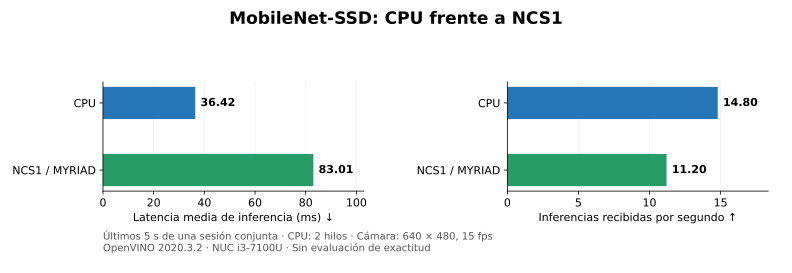

# Intel NCS Legacy Lab

Instalación de OpenVINO y detección de personas con **Intel Movidius Neural Compute Stick (NCS1)** en una Intel NUC con Ubuntu 24.04. La práctica permite ejecutar el mismo modelo en CPU y VPU y comparar su rendimiento.

El procedimiento principal es para **NCS1**. La configuración de NCS2 se describe aparte y tiene una limitación de carga de firmware pendiente de resolver.

## 1. Revisar el equipo

Se entregan tres NUC, identificadas como **ciberfisicos1**, **ciberfisicos2** y **ciberfisicos3**, con una computadora asignada por estudiante y su número de serie registrado en la entrega.

Cada equipo incluye carcasa, fuente y cable de alimentación, **8 GB de RAM**, SSD y un **NCS1**. La contraseña inicial es `1234567`; cada estudiante puede cambiarla con `passwd`.

Conecta el NCS1 directamente a un puerto USB 3.0 de la NUC. Utiliza un hub USB-C para teclado, ratón y cámara, y un cable HDMI para la pantalla. El tamaño del stick puede obstruir el puerto USB contiguo.

Manipula con cuidado la carcasa y los conectores. Para las prácticas, limita el uso del stick a **20 minutos continuos**, haz pausas para que se enfríe y utiliza ventilación adicional si está disponible.

[Material, registro de entrega y recomendaciones](docs/entrega-y-uso.md).

### Requisitos

- NUC x86_64 con Ubuntu 24.04 y acceso a una cuenta con permisos `sudo`.
- Conexión a Internet para descargar paquetes, runtime y modelo.
- NCS1 conectado directamente a USB 3.0.
- Cámara compatible con V4L2 que ofrezca YUYV a 640 × 480 y 15 fps.
- Sesión gráfica local para abrir el visor en la pantalla de la NUC.

| Componente | Configuración de referencia |
|---|---|
| NUC | NUC7i3BNK / placa NUC7i3BNB |
| CPU | Intel Core i3-7100U, 2 núcleos / 4 hilos |
| RAM | 8 GB |
| Almacenamiento | SSD; consultar la capacidad del equipo asignado |
| Sistema anfitrión | Ubuntu 24.04 |
| Contenedor NCS1 | Ubuntu 18.04, Python 3.6, OpenVINO 2020.3.2 |
| Cámaras compatibles con esta configuración | Logitech C910 y RealSense D435i, canal RGB |

El contenedor proporciona las bibliotecas antiguas que necesita MYRIAD sin sustituir Ubuntu ni Python del anfitrión. El kernel y la conexión USB siguen siendo los del anfitrión; un `venv` por sí solo no proporciona este entorno.

## 2. Habilitar SSH, si vas a instalar desde otra computadora

Conecta ambos equipos a la misma red. En una terminal de la NUC:

```bash
sudo apt update
sudo apt install openssh-server -y
sudo systemctl enable --now ssh
systemctl is-active ssh
```

El último comando debe mostrar `active`. Consulta los datos de conexión:

```bash
whoami
hostname
hostname -I
```

Desde la otra computadora:

```bash
ssh usuario@nombre-del-equipo.local
# Si el nombre .local no resuelve, utiliza la IP:
ssh usuario@IP_DE_LA_NUC
```

Sustituye el usuario y el equipo por sus valores reales. Si aparece `Connection refused`, revisa el servicio SSH y la dirección IP.

Puedes preparar los contenedores por SSH. El visor debe abrirse desde una terminal del escritorio gráfico de la NUC.

## 3. Descargar el repositorio y preparar Ubuntu

```bash
sudo apt update
sudo apt install git -y
git clone https://github.com/GerardoDC14/intel-ncs-legacy-lab.git
cd intel-ncs-legacy-lab
./scripts/setup-host.sh
```

El script instala Docker, FFmpeg y herramientas USB/V4L2, configura los grupos `plugdev` y `video` y añade las reglas udev del stick.

**Cierra sesión y vuelve a entrar** para aplicar los grupos. Desconecta y reconecta el NCS1 para aplicar los permisos USB. Después abre una terminal y vuelve a la carpeta:

```bash
cd ~/intel-ncs-legacy-lab
```

## 4. Construir el entorno y preparar el modelo

```bash
./scripts/build-runtime.sh ncs1
./scripts/prepare-mobilenet.sh
```

El primer comando construye el runtime OpenVINO 2020.3.2. El segundo descarga MobileNet-SSD, comprueba sus hashes y lo convierte a IR FP16 en un contenedor de conversión separado. Espera a que ambos terminen sin errores antes de continuar.

El modelo queda en `ncs1/work/models/mobilenet-ssd.xml` y `.bin`. [Modelo, preprocesamiento y alternativas](docs/modelos.md).

## 5. Comprobar el stick y la cámara

```bash
lsusb
v4l2-ctl --list-devices
```

El NCS1 aparece inicialmente como `03e7:2150`; después de cargar firmware puede aparecer como `03e7:f63b`. Ese último identificador también se utiliza en otros dispositivos Movidius.

Consulta los formatos del canal de vídeo que corresponda a tu cámara:

```bash
v4l2-ctl -d /dev/video0 --list-formats-ext
```

Debe ofrecer YUYV a 640 × 480 y 15 fps. En una RealSense selecciona el canal RGB, no profundidad ni infrarrojo. El número `/dev/videoN` puede cambiar al reconectar.

## 6. Abrir el visor

Desde una terminal del escritorio de la NUC:

```bash
cd ~/intel-ncs-legacy-lab
./ncs1/live.sh both
```

Introduce la contraseña cuando `sudo` la solicite. Los dos paneles deben mostrar vídeo y resultados de CPU y MYRIAD/NCS1. Cierra con **Q o Esc**.

Otros modos:

```bash
./ncs1/live.sh cpu
./ncs1/live.sh myriad
./ncs1/live.sh both --threshold 0.3
./ncs1/live.sh both --seconds 30
```

Para seleccionar la cámara manualmente:

```bash
NCS_CAMERA=/dev/video0 ./ncs1/live.sh both
```

Abre un solo visor. El modo `both` ejecuta un proceso por dispositivo a partir de una misma captura RGB; cada panel dibuja las cajas sobre el fotograma que procesó. Se descartan fotogramas pendientes para evitar acumular retraso.

El encabezado muestra latencia, inferencias/s, personas y antigüedad del resultado. La gráfica muestra los últimos 30 segundos de latencia, promedios de 5 segundos y diferencia `NCS1 − CPU`. Un valor positivo indica mayor latencia del stick. Las inferencias/s cuentan resultados recibidos; no son el inverso de la latencia.

El umbral predeterminado es 0.4. Puedes bajarlo para admitir detecciones con menor confianza, teniendo en cuenta que pueden aumentar los falsos positivos. La detección de personas sentadas u ocluidas debe evaluarse por separado del rendimiento.

## 7. Resolver problemas de inicio

| Problema | Qué hacer |
|---|---|
| `No RGB YUYV camera found` | Revisa conexión y formatos con V4L2; selecciona el canal RGB con `NCS_CAMERA`. |
| Fallo de acceso USB | Revisa las reglas de `setup-host.sh`, vuelve a iniciar sesión y reconecta el stick. |
| `NC_ERROR` al cargar MYRIAD | Espera el reset USB y el único reintento automático del lanzador. |
| El reintento vuelve a fallar | Cierra el visor, desconecta y reconecta físicamente el NCS1 y vuelve a abrirlo. |
| Otro visor ya está abierto | Ciérralo con Q o Esc antes de iniciar uno nuevo. |
| No aparece una ventana gráfica | Ejecuta el visor desde el escritorio local de la NUC. |

La recuperación automática actúa sobre fallos de carga inicial, después de cerrar el contenedor. No corta necesariamente la alimentación USB ni garantiza recuperar todos los bloqueos. [Procedimiento de recuperación](docs/ncs1-recuperacion.md).

## 8. Comparar CPU y NCS1

Usa el modo `both` para observar el comportamiento en vivo. Para medir inferencia sobre una imagen fija, sigue el [procedimiento de medición](docs/mediciones.md).



Esta referencia usa MobileNet-SSD, CPU con 2 hilos y cámara de 15 fps. Los valores son promedios de una ventana de 5 segundos: CPU **36.42 ms / 14.8 inferencias/s** y NCS1 **83.01 ms / 11.2 inferencias/s**. Son una referencia del equipo y la configuración indicados, no valores que deban reproducirse exactamente. No incluyen mediciones energéticas ni una evaluación de exactitud.

## Actualizar la instalación

Cierra el visor y ejecuta desde la carpeta del repositorio:

```bash
git pull --ff-only
./ncs1/live.sh both
```

Los cambios del lanzador y del visor Python no requieren reconstruir Docker ni convertir de nuevo el modelo. Revisa cualquier cambio local antes de actualizar.

## NCS2

El entorno NCS2 usa Ubuntu 20.04, Python 3.8 y OpenVINO 2022.3.2. Su carga de firmware tiene un fallo pendiente de resolver; utiliza NCS1 para completar la práctica. [Configuración y diagnóstico del NCS2](docs/ncs2.md).

## Contenido

- `ncs1/`: runtime, visor y benchmark estático.
- `ncs2/`: entorno de diagnóstico.
- `scripts/`: instalación, conversión, recuperación y generación de gráficas.
- `docs/`: instrucciones de entrega, modelos, medición y solución de problemas.
- `results/` y `figures/`: datos y gráficas de referencia.
