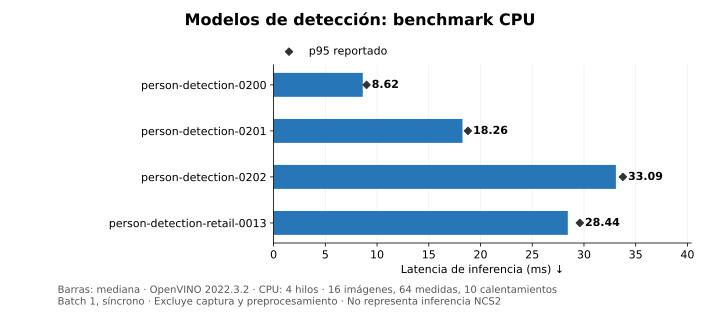

# Medir y comparar CPU y NCS1

## Comparación en vivo

Abre el visor con ambos dispositivos:

```bash
./ncs1/live.sh both
```

Observa estas métricas:

| Métrica | Interpretación |
|---|---|
| Latencia, ms | Tiempo de la llamada de inferencia; menor es mejor. |
| Inferencias/s | Resultados recibidos por segundo en una ventana de 5 segundos. |
| Antigüedad del resultado | Tiempo desde el resultado mostrado hasta el momento actual. |
| Diferencia NCS1 − CPU | Un valor positivo indica mayor latencia del stick. |

La tasa de resultados incluye las restricciones de captura, preprocesamiento, dibujo, planificación y colas. No equivale a `1000 / latencia`. Con una cámara de 15 fps, una CPU cercana a 15 resultados/s puede estar limitada por la captura.

## Benchmark sobre una imagen fija

Coloca una imagen en `ncs1/work/input.jpg`. Cierra el visor antes de medir y ejecuta los dispositivos por separado:

```bash
./ncs1/run.sh python3 /work/benchmark.py --device CPU --image /work/input.jpg
./ncs1/run.sh python3 /work/benchmark.py --device MYRIAD --image /work/input.jpg
```

El modelo predeterminado es MobileNet-SSD. El benchmark realiza 5 iteraciones de calentamiento y 20 medidas. Para cambiar esos valores:

```bash
./ncs1/run.sh python3 /work/benchmark.py --device MYRIAD --image /work/input.jpg --warmup 10 --iterations 100
```

Los resultados se guardan en `ncs1/work/benchmark-CPU.json` y `benchmark-MYRIAD.json`. Cada archivo incluye las duraciones individuales, mediana, p95, versión de OpenVINO y configuración de iteraciones.

La latencia mide únicamente `infer()`. La carga del modelo, lectura de imagen, preprocesamiento y dibujo quedan fuera del tiempo registrado. La configuración CPU de este benchmark es la predeterminada del runtime; la del visor utiliza 2 hilos y un stream.

## Condiciones de comparación

1. Usa el mismo modelo, precisión e imagen en ambos dispositivos.
2. Conserva la resolución y el preprocesamiento.
3. Registra CPU, RAM, sistema operativo, kernel y versión del runtime.
4. Indica calentamientos, iteraciones, hilos y streams cuando corresponda.
5. Compara dispositivos dentro de un mismo procedimiento; separa inferencia, pipeline y captura.

La velocidad no mide calidad de detección ni consumo energético. Para evaluar precisión o recall necesitas imágenes etiquetadas; para energía por inferencia necesitas una medición eléctrica.

## Valores de referencia

Los archivos de `results/` permiten contrastar los órdenes de magnitud. Sus métodos son distintos, por lo que deben interpretarse por separado.

### MobileNet-SSD en vivo

Fuente: [mobilenet-live.json](../results/mobilenet-live.json). NUC i3-7100U, OpenVINO 2020.3.2, CPU con 2 hilos y un stream, captura 640 × 480 a 15 fps. Ambos dispositivos activos; promedios de una ventana de 5 segundos.


| Dispositivo | Latencia media (ms) | Resultados/s |
|---|---:|---:|
| CPU | 36.42 | 14.8 |
| NCS1 / MYRIAD | 83.01 | 11.2 |

El archivo conserva los agregados finales, no una serie temporal completa. La escena de referencia no permite evaluar calidad de detección.

### Retail-0013 sobre una imagen fija

Fuentes: [CPU](../results/retail-static-CPU.json) y [MYRIAD](../results/retail-static-MYRIAD.json). OpenVINO 2020.3.2, batch 1, inferencia síncrona, 5 calentamientos y 20 medidas. Dispositivos ejecutados por separado; configuración CPU predeterminada.


| Dispositivo | Mediana (ms) | p95 (ms) |
|---|---:|---:|
| CPU | 28.99 | 29.14 |
| NCS1 / MYRIAD | 156.50 | 157.57 |

Estos archivos conservan los agregados. El rombo de la gráfica representa el p95, no un intervalo de confianza. La captura original no forma parte del benchmark que descargará el estudiante; utiliza una imagen propia.

### Modelos CPU con OpenVINO 2022.3.2

Fuente: [CSV](../results/openvino2022-cpu.csv) y archivos `*-CPU.json`. Batch 1, una solicitud síncrona, 4 hilos CPU, un stream, 10 calentamientos y 64 medidas sobre 16 imágenes repetidas cuatro veces.



| Modelo | Mediana (ms) | p95 (ms) |
|---|---:|---:|
| person-detection-0200 | 8.62 | 8.98 |
| person-detection-0201 | 18.26 | 18.79 |
| person-detection-0202 | 33.09 | 33.77 |
| person-detection-retail-0013 | 28.44 | 29.60 |

Estos valores corresponden a CPU, no al NCS2. El conteo de detecciones de los archivos no equivale a precisión o recall, porque las imágenes no tienen anotaciones de referencia.

En esos archivos, `pipeline_*` incluye resize, inferencia y filtrado de cajas, y excluye captura, decodificación, visualización y escritura. `serial_pipeline_fps` representa la tasa calculada de ese bucle, no FPS de cámara.

## Regenerar las gráficas de referencia

Desde la carpeta del repositorio:

```bash
sudo apt install python3-venv -y
python3 -m venv .venv
.venv/bin/pip install -r scripts/requirements-plots.txt
.venv/bin/python scripts/plot_results.py
```

El script genera los archivos SVG y PNG en `figures/` a partir de los datos incluidos en `results/`. Para comparar nuevas mediciones, conserva su configuración y método junto con los resultados.
